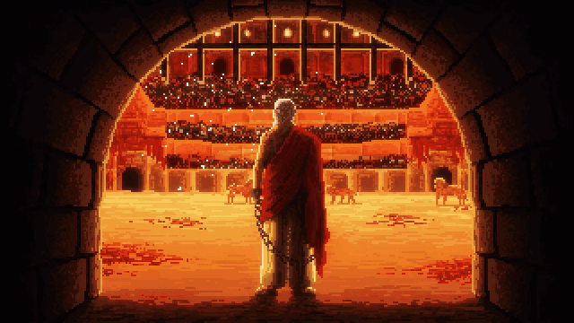
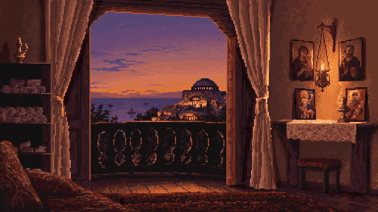

# Live Wallpaper

**Runs every day on my Mac.** It plays my rotation of nine pixel-art clips behind the desktop icons.

Live Wallpaper turns short pixel-art videos into a moving Mac desktop. A small Swift app plays the clips behind your icons and switches to the next one every 15 minutes. A shell pipeline takes a link to an Instagram reel and turns it into a clean 4K loop. It downloads the video, finds black frames and the jump where the clip restarts, fixes both, upscales the pixel art with Real-ESRGAN, and adds it to the rotation.

Eight of the nine clips in my rotation are by **[Lukyan Art](https://www.instagram.com/lukyan_illustrations/)**. The odd one out, a knight above a storm sea, is a reel by **[Lost Kingdom](https://www.instagram.com/lostkingdom.mov/)** that the pipeline turns into pixel art. Anyone can get the same nine: `clips.txt` lists the reels, and `tools/get-clips.sh` downloads and builds all of them. The video files aren't uploaded here because they are the artists' work (and the 4K files are too big for GitHub), so each copy comes straight from the original posts. Go follow them.

## What it looks like

Six seconds from two of the clips, shrunk down. On the desktop they play at 4K and loop.

| Polycarp in the arena | Constantinople from the icon room |
|---|---|
|  |  |
| [Original reel](https://www.instagram.com/reel/De9e--4BQkz/) by Lukyan Art | [Original reel](https://www.instagram.com/reel/DfpOHlOhFw5/) by Lukyan Art |

## Why I built this

I kept saving pixel-art reels on Instagram, scenes like Gethsemane, an icon room, and the empty tomb, and I wanted them on my Mac instead of sitting in my saved folder. The Mac doesn't have a way to use a video as your wallpaper, so I built a small player that sits behind the desktop and rotates through them every 15 minutes. Once they were up on a big screen, the 720p downloads looked soft, so I added an upscaling step that redraws each frame at 4K. Then the newest clip turned out to have almost a second of black in the middle of it, and that is how the pipeline ended up checking every clip before it goes up.

## How it works

1. **Download.** `tools/add-reel.sh` pulls the reel with yt-dlp.
2. **Check.** `tools/check_clip.py` shrinks each frame to 160x90, then looks for black frames and compares the last frame with the first. If the jump at the loop point is more than twice the biggest normal frame-to-frame change, the loop will visibly pop.
3. **Fix.** If a clip fails, the checker keeps its longest stretch without black frames. It then fades the last second into the first second, so the final frame is the frame just before the loop point and the clip restarts without a jump.
4. **Upscale.** `tools/upscale.sh` splits the clip into frames and runs Real-ESRGAN's `realesr-animevideov3` model on each one: 4x for 720p sources, 2x for 1080p. It then encodes the result as 4K HEVC.
5. **Fit the screen (only for portrait reels).** A reel is tall and a Mac screen is wide. `--crop=W:H:X:Y` cuts a landscape window out of it. `--extend` keeps the whole reel in the middle and runs `tools/extend_sides.py`, which builds new sides out of patches of the reel's own sky and ground, lined up on the art's pixel grid and never copied from the figure. `--pixel` runs `tools/pixelate.sh` on ordinary footage: it shrinks it to a coarse grid and limits it to one 40-colour palette for the whole clip.
6. **Play.** `src/main.swift` (AppKit + AVFoundation) puts a borderless window at desktop level on every screen and loops the clip with `AVPlayerLooper`. It moves to the next clip every 15 minutes. A 🖼 menu in the menu bar has Next wallpaper, Pause / Resume, and Quit.

### Problems I ran into

- **Black frames in a downloaded reel.** The empty tomb reel goes black for 24 frames (0.8 s) in the middle, so the desktop went black every 20 seconds. That is why the checker exists.
- **Loops that jump.** Most reels aren't made to loop. My first fix used ffmpeg's `xfade`, but its last frame is still partly the old picture, so the loop still popped. The fix now builds the blend by hand with an alpha fade, which ends exactly on the frame before the loop point.
- **A black flash on every switch.** The player used to swap in the next clip before its first frame was decoded. Now the new clip goes on a second layer and fades in only once `isReadyForDisplay` is true.
- **Decoding 4K for nobody.** One night the player decoded about 785,000 frames but only about 37,000 reached the screen, because it kept going with the display off. It now pauses when the screen sleeps or locks, and starts again when you come back.
- **The upscaler crashed with no error.** Real-ESRGAN looks for its models relative to the current folder, so it segfaulted whenever the script ran from anywhere else. The script now passes `-m` with the full path.

## Tech stack

- **Swift** (AppKit, AVFoundation, Core Animation) for the player, built with `swiftc`, no Xcode project
- **Python** with NumPy for the clip checker, and OpenCV for growing the sides of a portrait reel
- **Bash** for the pipeline
- **ffmpeg** for frames, trimming, the loop blend, and HEVC encoding (VideoToolbox)
- **yt-dlp** for downloading
- **[Real-ESRGAN](https://github.com/xinntao/Real-ESRGAN)** (ncnn-vulkan build) for upscaling
- **launchd** to start the player at login

I built it with help from Claude Code.

## Run it

Needs macOS (Apple Silicon or Intel), the Xcode command line tools, Homebrew for ffmpeg and yt-dlp, and Python 3 (setup installs NumPy and OpenCV). The player reads clips from `~/Wallpapers/clips-hd`, so clone the repo there.

```bash
xcode-select --install          # if swiftc is missing
brew install ffmpeg yt-dlp
git clone https://github.com/jeremiah123-luma/live-wallpaper.git ~/Wallpapers
cd ~/Wallpapers
tools/setup.sh                  # downloads Real-ESRGAN, builds the player, starts it at login
tools/get-clips.sh              # gets my nine clips (10 minutes to an hour each, mostly upscaling)
```

To add your own reel instead, or on top of mine:

```bash
tools/add-reel.sh "https://www.instagram.com/reel/..." my-clip
```

`add-reel.sh` numbers clips in the order you add them, and they play in that order. To check a clip without changing anything, run `python3 tools/check_clip.py clips-hd/1-my-clip.mp4`. To test rotation without waiting 15 minutes, run `LW_ROTATE=6 ./LiveWallpaper` (after stopping the login agent).

## Folder layout

| Path | What's there | In git |
|---|---|---|
| `src/main.swift` | the player | yes |
| `clips.txt` | links to the nine reels in my rotation, with each one's options | yes |
| `tools/` | setup, get-clips, add-reel, upscale, the clip checker, extend_sides, and pixelate | yes |
| `preview/` | the two short previews shown above | yes |
| `clips-src/` | downloaded (and fixed) clips | no |
| `clips-hd/` | the 4K clips the player plays | no |
| `stills/` | one frame from each clip, for a normal desktop picture | no |
| `tools/resr/` | Real-ESRGAN, downloaded by setup | no |

## License

MIT. See [LICENSE](LICENSE). Real-ESRGAN is BSD-3-Clause and is downloaded, not included.
